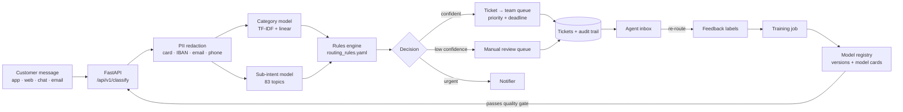

# Architecture

## Request flow

## Components

| Component | Code | Responsibility |
|---|---|---|
| Config | `bankq/config.py` | All settings from `BANKQ_*` environment variables or `.env` |
| Taxonomy | `bankq/taxonomy.py` | Categories, teams, priorities, response deadlines, intent → category map |
| Data | `bankq/data/` | Load Banking77 and generated loan data, normalise text, validate (schema, duplicates, train/test leakage) |
| Training | `bankq/ml/train.py` | Grid-search 4 model families with 5-fold CV, train category and sub-intent models, evaluate, run the quality gate, write a model card |
| Registry | `bankq/ml/registry.py` | Versioned artifacts in `models/registry/`; a `production.json` pointer; promote and list |
| Predictor | `bankq/ml/predictor.py` | Loads the production version; category probabilities, top sub-intents, word-level explanation |
| PII | `bankq/routing/pii.py` | Masks card numbers (Luhn-checked), IBANs, sort codes, account numbers, emails, phones |
| Rules | `bankq/routing/rules.py`, `configs/routing_rules.yaml` | Review threshold, fraud keyword escalation, priority overrides; editable without retraining |
| Router | `bankq/routing/router.py` | Redact → predict → apply rules → team, priority, deadline, audit of rules applied |
| Storage | `bankq/db/` | SQLAlchemy models (tickets, ticket events), repository, analytics queries. SQLite by default; any SQLAlchemy URL |
| API | `bankq/api/` | Versioned REST API, API keys, rate limiting, request IDs, JSON logs, Prometheus metrics, health and readiness |
| UI | `web/` | Route, Inbox, Batch, Analytics and Model views (plain HTML/CSS/JS, served by the API) |

## Design decisions

**Two models instead of one.** The category model (5 classes) decides routing; the sub-intent model (83 classes) gives agents the specific topic. Mapping the 83-class prediction up to a category would route almost as accurately (97.2% vs 97.3% on the test set). The separate category model exists because its probabilities are what the review threshold and the fraud rule act on, and because agent feedback only carries a category label, so only the category model can learn from it. The sub-intent is shown restricted to the predicted category so the two never contradict each other.

**Model selection on cross-validation, not the test set.** Choosing by test score leaks the test set into model selection and overstates real performance.

**A quality gate before production.** A new version is promoted only if it clears fixed thresholds (macro F1, fraud recall, topic accuracy) and does not regress more than 1 point against the current production model. CI fails if the gate fails.

**Rules on top of the model.** The model optimises average accuracy; the business cares disproportionately about fraud. The fraud rule has two tiers. *Strong phrases* ("skimmed", "cloned", "scam", "wasn't me") escalate to Fraud on their own. TF-IDF has no notion of what "skimmed" means; it routes "My card was skimmed at the ATM" to Cards at 100%. *Ambiguous words* ("fraud", "suspicious", "stolen") escalate only when the model also gives fraud at least 10%, so "how do I report fraud on a loan application" still goes to Loans. A fine-tuned transformer (TASKS.md #1) should need this net less often.

**PII is masked before anything else.** The model, the database, and the logs only ever see the masked text. Placeholders like `[CARD]` are kept so agents know something was there.

**Feedback loop.** When an agent re-routes a ticket, the corrected category is stored. `make retrain` adds these corrections to the training data (never to the fixed test set) and registers a new version that must pass the same gate.

**Hot reload.** `POST /api/v1/admin/reload-model` swaps to the current production model and re-reads the rules file without downtime.

## Scaling notes

- The rate limiter is in-process; with several replicas, move it to Redis.
- The container runs one uvicorn worker: with SQLite, several workers race to create tables on startup. Scale by running more containers against Postgres.
- SQLite is fine for a demo and a single instance. For production set `BANKQ_DATABASE_URL` to Postgres (TASKS.md #4 adds migrations).
- Inference is about 1 ms per message on a laptop CPU. The explanation step re-scores the message once per word, so batch endpoints skip it.
